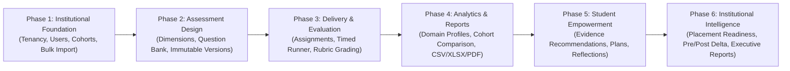

# Concept Document — MCA Career Compass

**Institutional MCA Student Talent Mapping & Empowerment Platform**

---

## 1. Executive Summary & Vision

**MCA Career Compass** is a multi-institution educational assessment, talent mapping, and student empowerment platform purpose-built for **Master of Computer Applications (MCA)** departments.

Higher education institutions frequently assess MCA students using fragmented spreadsheets, one-off technical quizzes, or opaque employability scores that mix objective coding ability with subjective confidence surveys. **MCA Career Compass** solves this by providing an end-to-end, auditable platform that:

1. Measures student capabilities across technical, cognitive, professional, and career-interest dimensions.
2. Keeps **Demonstrated Performance**, **Self-Reported Proficiency**, and **Stated Career Interest** strictly separated across scoring, analytics, recommendations, and exports.
3. Translates assessment evidence into explainable, evidence-cited learning pathways, training recommendations, portfolio projects, certifications, and mentored development plans.
4. Gives Faculty, Heads of Department (HODs), and Institution Administrators cohort-scoped intelligence, Pre/Post assessment impact tracking, Placement Readiness indicators, and executive CSV/XLSX/PDF reports.

---

## 2. Core Design Principles & Guardrails

### 2.1 Strict Measurement-Family Separation
Every assessment dimension and question belongs explicitly to one of three independent measurement families:

| Measurement Family | Purpose | Scoring Rules |
| --- | --- | --- |
| **Demonstrated Performance** | Objective capability & rubric-evaluated work (MCQ, True/False, Numeric, Situational Judgement, Descriptive, Coding) | Marks, optional negative marking, rubric criteria, normalized percentage (`0–100%`) |
| **Self-Reported Proficiency** | Student's perceived comfort/confidence (Likert / Self-Rating items) | Average rating (`1–5` scale); **never** contributes marks to Demonstrated Performance |
| **Stated Career Interest** | Student's career track preferences (e.g., SDE, AI/ML, Data Analytics, Cloud/DevOps, Cybersecurity, UI/UX) | Average interest rating (`1–5` scale); **never** collapsed into technical scores |

### 2.2 Non-Clinical & Empowerment-First Boundary
- Scores, domain-fit signals, and Placement Readiness bands are strictly **educational empowerment indicators** — never a clinical or validated psychological diagnosis, and never an automated exclusion tool.
- Every report, recommendation view, analytics screen, and export displays the explicit non-clinical educational notice.

### 2.3 Evidence-Cited Explainability (No Black-Box Scores)
- Recommendations never emit ungrounded advice: every suggested domain, learning pathway, training workshop, project, or certification explicitly cites the underlying student evidence (e.g., *"Addresses skill gap in DSA (0.0% demonstrated)"* or *"Stated career interest: INT_AIML (5.0/5)"*).
- Placement Readiness bands (`Placement Ready`, `Near Ready`, `Foundational Support Needed`, `Insufficient Assessment Data`) show the exact demonstrated overall %, core technical %, and lowest-domain criteria alongside each student row.

---

## 3. Stakeholders & Role-Based Governance

| Role | Login Portal | Institutional Scope | Primary Responsibilities |
| --- | --- | --- | --- |
| **Platform Super Admin** | `/admin/login` | Platform-wide (no institution context required) | Create/activate/deactivate institutions, provision Institution Admins, review platform-wide audit logs |
| **Institution Admin** | `/admin/login` | Single active institution | Manage institution profile, users & roles, programmes/cohorts, manual & bulk student onboarding, faculty-cohort assignments, learning catalogue, and executive reports |
| **Assessment Admin** | `/admin/login` | Single active institution | Maintain dimensions & skill tags, author question banks & rubrics, build/publish immutable assessment versions, schedule assignments, evaluate manual responses, manage learning catalogue & executive reports |
| **Faculty / HOD** | `/login` | Assigned cohorts only (`CohortFaculty`) | View assigned students, grade descriptive/coding responses, inspect cohort analytics, mentor student development plans, monitor Faculty Intelligence & Pre/Post comparisons |
| **Student** | `/login` | Self-only (`active_membership`) | Take timed assessments with autosave, view released personal results, review career domain-fit & learning recommendations, propose development plans, log progress (0–100%) & reflections |

---

## 4. End-to-End Platform Lifecycle (Phases 1–6)

1. **Phase 1 — Institutional Foundation**: Multi-tenant onboarding, portal-separated authentication (`/admin/login` vs `/login`), granular RBAC, academic hierarchy (`Programme → AcademicYear → Cohort`), Faculty/HOD cohort assignments, staged Excel/CSV import validation, and append-only `AuditEvent` logging.
2. **Phase 2 — Assessment Configuration**: Categories, dimensions, dynamic question bank (`8` question types), negative marking/rubrics, draft template builder, and immutable published `AssessmentVersion` snapshots.
3. **Phase 3 — Delivery & Evaluation**: Cohort/individual assignments with open/close windows, server-authoritative countdown timers, idempotent autosave, instant objective scoring from version snapshots, and a manual evaluation queue for descriptive/coding responses.
4. **Phase 4 — Analytics & Exports**: Individual domain profiles, cohort strengths (`>= 70%`) and priority gaps (`< 50%`), score distributions, student comparison tables, and formula-safe CSV, XLSX, and PDF exports.
5. **Phase 5 — Student Empowerment**: Institutional catalogue of Learning Pathways, Trainings, Projects, and Certifications; domain-fit mapping; student-proposed & faculty-mentored `DevelopmentPlan` workflows; and milestone `ProgressRecord` logs (auto-completing plans when all activities reach `100%`).
6. **Phase 6 — Institutional Workflows & Intelligence**: Cohort-scoped Faculty/HOD Intelligence dashboards, transparent Placement Readiness classification, Pre/Post assessment delta tracking (template pair or earliest-vs-latest), and Institution Executive Reports with CSV/XLSX/PDF exports.

---

## 5. Multi-Institution Architecture & Security Model

- **Technology Stack**: React + TypeScript + Vite + Tailwind CSS (`frontend/`), Django + Django REST Framework + Gunicorn (`backend/`), PostgreSQL 15+ (`UUID` primary keys, `TIMESTAMPTZ` UTC timestamps), Nginx HTTPS reverse proxy.
- **Strict Logical Isolation**: Shared PostgreSQL schema where every tenant-owned entity carries `institution_id` and composite database foreign keys `(child_fk, institution_id) -> parent(id, institution_id)` prevent cross-tenant linking even at the SQL level.
- **Server-Derived Tenant Context**: Client-submitted `institution_id` parameters are never trusted for authorization; `request.active_institution` and `request.active_membership` are resolved strictly from the authenticated server session.
- **Credential & Audit Hygiene**: Bulk-imported accounts initialize with unusable passwords; password resets use one-time signed tokens; CSV/XLSX exports sanitize formula prefixes (`=`, `+`, `-`, `@`); and sensitive mutations emit scrubbed `AuditEvent` records with HMAC-hashed client IPs.

